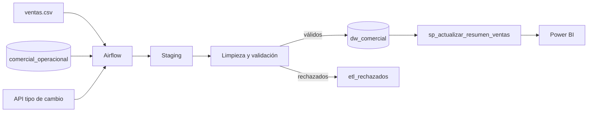

# Proyecto Integrador ETL + Data Warehouse + BI — Comercial GT

Proceso ETL automatizado con **Apache Airflow** que integra tres fuentes (CSV, PostgreSQL y API REST), limpia los datos, los carga en un Data Warehouse (modelo estrella) en **Neon (PostgreSQL)**, consolida un resumen con un Stored Procedure y lo muestra en **Power BI**.

**Autor:** Iosef Canchán — Base de Datos II, UPANA

## Arquitectura



## Estructura

```
airflow/dags/etl_comercial_ventas.py   DAG con las 9 tareas
etl/                                   extract_csv, extract_postgres, extract_api, transform, load
database/                              comercial_operacional.sql, datawarehouse.sql, stored_procedures.sql
data/ventas.csv                        archivo de ventas (y evidencias generadas)
dashboard/tablero_comercial.pbix       tablero de Power BI
docker-compose.yml  .env.example       Airflow en Docker y plantilla de conexiones
```

## Requisitos

- Docker Desktop
- Una cuenta de Neon con dos bases: `comercial_operacional` y `dw_comercial`
- Power BI Desktop (solo para el tablero)

## Cómo ejecutarlo

1. **Conexiones:** copia `.env.example` como `.env` y pon tus datos de Neon (`NEON_OPERACIONAL_URI` y `NEON_DW_URI`, con `?sslmode=require`). El `.env` no se sube al repositorio.
2. **Bases de datos:** en el SQL Editor de Neon ejecuta:
   - `database/comercial_operacional.sql` en la base `comercial_operacional`
   - `database/datawarehouse.sql` y luego `database/stored_procedures.sql` en la base `dw_comercial`
3. **Airflow:** con Docker Desktop abierto, corre `docker compose up -d` y espera unos minutos.
4. **Entrar:** abre `http://localhost:8080`. Usuario `admin`; contraseña con:
   `docker compose exec airflow cat /opt/airflow/standalone_admin_password.txt`
5. **Ejecutar:** activa el DAG `etl_comercial_ventas` y presiona **Trigger**. Todas las tareas deben quedar en verde.

## Cómo verificar (en Neon, base `dw_comercial`)

```sql
SELECT * FROM etl_log ORDER BY id_ejecucion;          -- estado y conteos por ejecución
SELECT COUNT(*) FROM fact_ventas;                      -- ventas válidas cargadas
SELECT id_origen, motivo FROM etl_rechazados;          -- rechazos con su motivo
SELECT * FROM resumen_ventas ORDER BY fecha;           -- resumen por fecha, sucursal y categoría
```

**Reejecución:** si se vuelve a presionar Trigger, `etl_log` debe mostrar `filas_cargadas = 0` y `fact_ventas` no cambia (no se duplican ventas ni resúmenes).

## Reglas de calidad (resumen)

- Fechas en varios formatos se normalizan; si no se pueden interpretar, se rechazan.
- Descuento nulo = 0; vendedor vacío = `NO ASIGNADO`; TRIM y mayúsculas en textos.
- Venta duplicada (por `id_venta`): se conserva la primera y las demás se rechazan con motivo.
- Cliente, producto o sucursal inexistente, cantidad ≤ 0, precio negativo, moneda desconocida o descuento mayor al total: se rechazan con motivo en `etl_rechazados`.
- USD se convierte a GTQ con la tasa de la API; se conservan el importe y la moneda originales.

**Decisión documentada:** el tipo de cambio es el capturado al ejecutar el ETL; no es la tasa histórica de la fecha de cada venta.

## Reintentos y errores

Cada tarea se reintenta 3 veces (1 minuto entre intentos). Si agota los reintentos, la ejecución queda en estado `ERROR` en `etl_log` con la tarea y el mensaje. Las credenciales viven en `.env`, nunca en el código.

## Power BI

Abrir `dashboard/tablero_comercial.pbix`, o conectar Power BI a `dw_comercial` (PostgreSQL, host de Neon, puerto 5432) e importar las dimensiones, `fact_ventas` y `resumen_ventas`.
